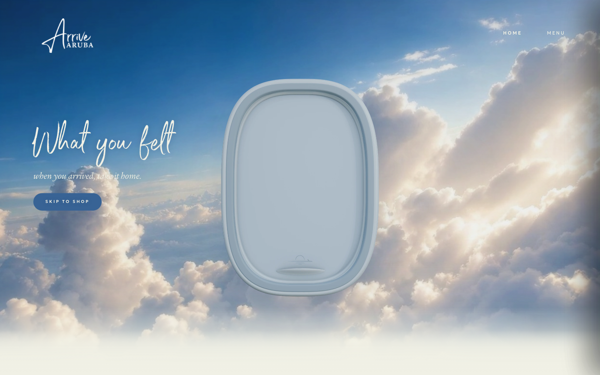
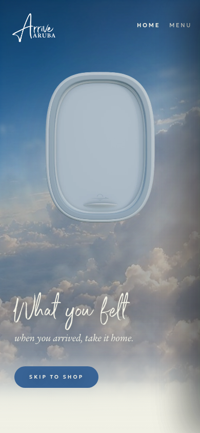

# Arrive Aruba — Web & App

An editorial resortwear website and mobile app prototype inspired by the experience of arriving in Aruba. A portfolio project by [Martin Morfe](https://github.com/morfemartin).

[Live website](https://morfemartin.github.io/Web_Arrive-Aruba/Arrive%20Aruba%20-%20Homepage.dc.html) · [Mobile app prototype](https://morfemartin.github.io/Web_Arrive-Aruba/Arrive%20Aruba%20-%20App.dc.html) · [Independent 3D / Journey project](https://github.com/morfemartin/Web_Arrive-Aruba-3D)



## The project

The site combines an immersive window hero with an editorial collection, product pages and a mobile app flow. The visual language uses the Star Sapphire and Cannoli Cream palette, ITC Legacy Serif, Port Blair and the Arrive Aruba star.

The repository demonstrates responsive interface development, translation of brand direction into reusable styles, scroll-driven canvas animation, reduced-motion fallbacks and browser-local cart state. The storefront is a static interactive prototype: it does not process payments or provide a production commerce backend.

## Explore the work

- Responsive homepage with the window / Journey experience already present in the approved `main` version.
- Collection and product pages with shared interaction code.
- Mobile app prototype covering login, browsing, cart, checkout screens and profile. These flows are demonstrations, not authenticated services.
- [Original wireframes](docs/design/wireframes.pdf) and [app flow](docs/design/app-flow.pdf).
- [Design system](./_ds/arrive-aruba-design-system-4dc78757-60e4-49ce-82d5-c2f33f185275/readme.md), including tokens and typography.
- [Architecture and repository scope](docs/ARCHITECTURE.md).

<details>
<summary>Mobile homepage screenshot</summary>



</details>

## Run locally

No installation or build is required. From the repository root:

```sh
python3 -m http.server 8000
```

Open `http://localhost:8000/`. The launcher opens the app prototype on mobile and the homepage on desktop. Use `?view=web` or `?view=app` to choose explicitly.

The pages use HTML/CSS, JavaScript and a bundled React/Babel runtime in `support.js` and `vendor/`. Brand fonts are local; Geologica is requested from Google Fonts.

## Repository boundaries

`main` contains the final web source and selected portfolio material. Further 3D experiments belong in [Web_Arrive-Aruba-3D](https://github.com/morfemartin/Web_Arrive-Aruba-3D), which has its own [Pages demo](https://morfemartin.github.io/Web_Arrive-Aruba-3D/).

The original live site still publishes from `gh-pages`. That branch includes later Journey changes and is intentionally independent of this cleanup of `main`; the live preview can therefore differ from the screenshots of `main` above. Do not overwrite `gh-pages` with `main` without reviewing those differences.

Unused reference captures, duplicate documents, unused media and the legacy Shopify deployment scaffold have been removed from the current source. Historical work remains recoverable in Git. Deleting files reduces the checked-out source size; it does not remove those files from Git history or guarantee a smaller full clone.

## Development and verification

Use descriptive `codex/` branches and pull requests. Check desktop and mobile routes, product and collection pages, local asset requests, and reduced motion before merging. Never commit `.env` files, credentials or private keys.

The historical [hero handoff](HANDOFF.md) and [mobile baseline](MOBILE-HERO-BASELINE.md) preserve implementation decisions; their branch pointers and publication notes describe earlier checkpoints.

## Credits

Maintained by Martin Morfe. Existing contributor attribution is preserved in Git history. Arrive Aruba branding and bundled fonts remain subject to their respective owners' rights; this repository does not grant a license to reuse those assets.
